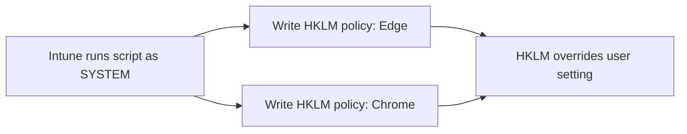

# Browser-Policy

Enforce the Edge and Chrome homepage through an Intune remediation.

## The problem it solves

Users change their browser homepage, and a per-user setting is easy for them to change back. A machine-level policy can't be changed by the user.

## How it works

The script writes the homepage and new-tab policy under `HKLM\SOFTWARE\Policies` for Edge and Chrome. HKLM policy overrides anything under HKCU, so the user can't override it.

## Scripts

| Script | What it does | Changes anything? |
|--------|--------------|-------------------|
| `Detect-BrowserHomepage.ps1` | 🔍 Detection script. Exits 1 if the Edge or Chrome policy is missing or wrong, so Intune runs the fix. | No, read-only |
| `Set-BrowserHomepage.ps1` | ✏️ Remediation script. Writes the Edge and Chrome homepage policy to HKLM. | **Writes to the registry.** No dry-run. It's meant to run as SYSTEM through Intune. |

## Setup in Intune

Devices > Scripts and remediations > Create. Upload `Detect-BrowserHomepage.ps1` as the detection script and `Set-BrowserHomepage.ps1` as the remediation script. Keep the two URLs identical in both files. Run as SYSTEM, 64-bit.

## Good to know

- Set `$homepageUrl` and `$newTabUrl` at the top first. They're placeholders.
- ⚠️ Pilot on a small group. A wrong URL here applies to every device in the assignment.
- To undo it, remove the policy values it created.
