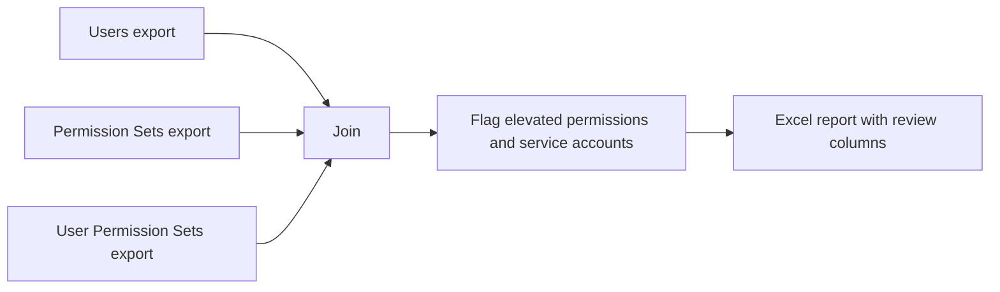

# Business-Central

User access review report for Dynamics 365 Business Central.

## The problem it solves

Auditors want to know who can post journals, edit bank data or administer the system. In Business Central that answer is split across Users, Permission Sets and User Permission Sets, and the last one can be hundreds of thousands of rows.

## How it works



You export the three tables from Business Central. The script joins them, flags permission sets that match an elevated list (for example SUPER, SECURITY, journal posting, bank edit), and writes an Excel report with columns for the reviewer to sign off.

## Scripts

| Script | What it does | Changes anything? |
|--------|--------------|-------------------|
| `Build-BCAccessReport.ps1` | 🔍 Builds the access review report from three exports. | No. Works on exported files only and never connects to Business Central. |

## Quick start

```powershell
.\Build-BCAccessReport.ps1 -UsersFile Users.xlsx -PermSetsFile PermissionSets.xlsx -UserPermSetsFile UserPermSets.csv
```

## Requirements

- PowerShell 7 and ImportExcel.

## Good to know

- Export **User Permission Sets as CSV**. An xlsx with 500K+ rows can hang ImportExcel for 10 minutes or more.
- The elevated-permission patterns are at the top of the script. Edit them to match your setup.
