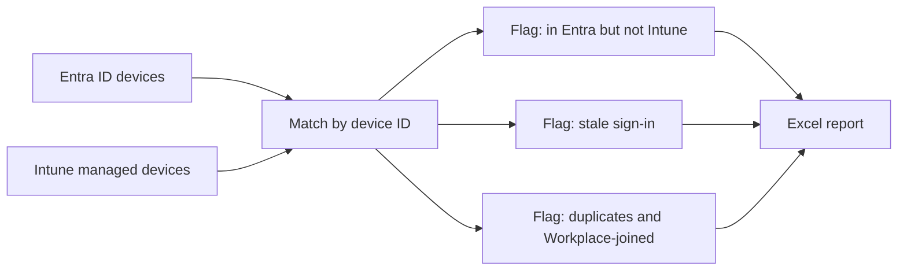

# Entra-ID

Device inventory and stale-device detection by comparing Entra ID with Intune.

## The problem it solves

In a hybrid environment the same laptop can appear several times: once in Entra ID, once in Intune, and again as a duplicate with a different join type. Remote desktop sessions can also leave Workplace-joined records behind. Over time nobody can say which records are real.

## How it works



Both scripts pull Windows devices from Graph, page through all results, join the two lists, and write an Excel report.

## Scripts

| Script | What it does | Changes anything? |
|--------|--------------|-------------------|
| `Get-DeviceInventory.ps1` | 🔍 One merged inventory: ownership, join type, OS version, compliance and last activity. | No |
| `Get-StaleDevices.ps1` | 🔍 Flags orphaned, stale and duplicate records (`-StaleDays`, default 30). | No |

To act on the stale list, see `Remove-StaleDevices.ps1` in [Intune](../Intune), which has `-DryRun`.

## Quick start

```powershell
.\Get-DeviceInventory.ps1
.\Get-StaleDevices.ps1 -StaleDays 60
```

Reports are written to `..\Reports`.

## Requirements

- PowerShell 7, ImportExcel, and an app registration (see [Graph-API](../Graph-API)).
- Graph read permissions for devices and Intune managed devices.

## Good to know

- Sign-in time in Entra is approximate and can lag, so treat "stale" as a list to check, not a delete list.
