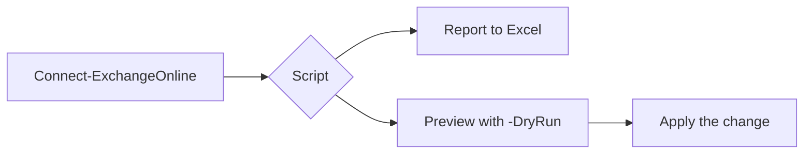

# Exchange

Mailbox reporting, calendar delegate management and distribution list membership for Exchange Online.

## The problem it solves

Mailbox permissions and list membership change constantly and are tedious in the admin centre. These scripts report on them and make bulk changes with a preview step first.

## How it works



1. Each script connects with the ExchangeOnlineManagement module.
2. Reports read and export. Change scripts take `-DryRun` so you see the planned changes first.

## Scripts

| Script | What it does | Changes anything? |
|--------|--------------|-------------------|
| `Get-MailboxReport.ps1` | 🔍 Mailbox size, permissions and delegates for all, user or shared mailboxes. | No |
| `Update-CalendarPermissions.ps1` | ✏️ Add, change or remove calendar delegates. `-Action List` (default) only reads. | **Add and Remove change permissions.** `-DryRun` for both. No confirmation prompt on Remove. |
| `Update-DistributionList.ps1` | ✏️ Add or remove list members from a CSV with columns `Email` and `Action`. | **Changes membership.** `-DryRun`. No confirmation prompt. |

## Quick start

```powershell
# Shared mailboxes only
.\Get-MailboxReport.ps1 -MailboxType Shared

# See who has access to a calendar
.\Update-CalendarPermissions.ps1 -Mailbox "user@domain.com" -Action List

# Preview a list update, then apply it
.\Update-DistributionList.ps1 -DLAddress "team@domain.com" -InputFile members.csv -DryRun
.\Update-DistributionList.ps1 -DLAddress "team@domain.com" -InputFile members.csv
```

## Requirements

- PowerShell 7 and the [ExchangeOnlineManagement](https://www.powershellgallery.com/packages/ExchangeOnlineManagement) module.
- An account with the Exchange roles to read or manage recipients.
- ImportExcel for the report.

## Good to know

- ⚠️ Neither change script asks "are you sure". Run `-DryRun` first.
- Test on a throwaway mailbox and list before pointing these at real ones.
