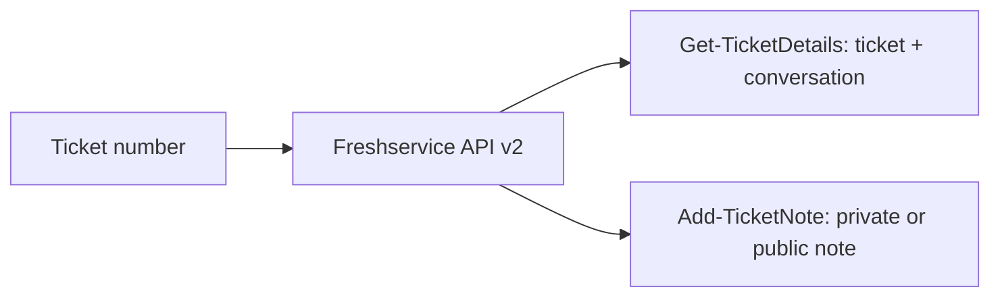

# Freshservice

Read ticket details and post notes from the command line.

## The problem it solves

When you are already in a terminal fixing something, switching to the browser to read a ticket or log what you did slows you down. These scripts do both through the Freshservice REST API.

## How it works



Both use API-key basic auth (the key is the username, `X` the password).

## Scripts

| Script | What it does | Changes anything? |
|--------|--------------|-------------------|
| `Get-TicketDetails.ps1` | 🔍 Shows a ticket's fields plus its notes and replies. | No |
| `Add-TicketNote.ps1` | ✏️ Posts a note. Private by default, visible to the requester with `-Public`. | **Posts to the ticket.** No dry-run, and a posted note can't be undone. |

## Quick start

1. Set `$freshDomain` and `$apiKey` at the top of each script.
2. Run:

```powershell
.\Get-TicketDetails.ps1 -TicketId 12345
.\Add-TicketNote.ps1 -TicketId 12345 -Body "Updated firmware and rebooted the device."
```

## Requirements

- A Freshservice API key with access to the tickets you query.

## Good to know

- ⚠️ `-Public` emails the requester. Leave it off unless that's what you want.
- Don't commit your API key.
