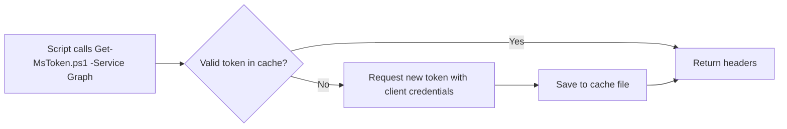

# Graph-API

Shared sign-in helper. Almost every other script in this repo calls it to get an access token.

## The problem it solves

Each script that talks to Microsoft Graph needs a token. Signing in on every run is slow and hits rate limits. `Get-MsToken.ps1` signs in once with a client secret, caches the token, and reuses it until it expires.

## How it works



1. Pick the service: `Graph`, `Exchange`, `SharePoint` or `Azure`.
2. The script checks the cache file in your user profile for an unexpired token for that service.
3. If there is none, it requests a new one and saves it.
4. It returns a headers hashtable ready for `Invoke-RestMethod`.

## Scripts

| Script | What it does | Changes anything? |
|--------|--------------|-------------------|
| `Get-MsToken.ps1` | 🔍 Gets and caches an access token. | Nothing in the tenant. Writes a local cache file. |

## Quick start

```powershell
$env:GRAPH_TENANT_ID     = "your-tenant-id"
$env:GRAPH_CLIENT_ID     = "your-app-client-id"
$env:GRAPH_CLIENT_SECRET = "your-secret"

$headers = .\Get-MsToken.ps1 -Service Graph
Invoke-RestMethod -Uri "https://graph.microsoft.com/v1.0/organization" -Headers $headers
```

## Requirements

- An Entra app registration with a client secret.
- The Graph application permissions for whatever the calling script does. Grant the least that covers it.

## Good to know

- ⚠️ The cache file (`.graph-token-cache.json` in your profile) holds live tokens in plain text. Never copy it into a repo. The `.gitignore` already excludes it.
- Prefer the environment variables over editing the secret into the file.
