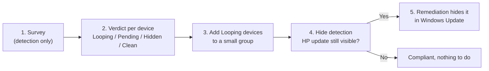

# HP Driver Update Loop

Stops Windows Update from re-offering the same broken HP printer driver every few days (error `0x80246007`), without blocking any other driver updates.

## The problem it solves

Windows Update keeps offering `Hewlett-Packard - USB - 4/8/2019 - 1.0.0.237` (HP LaserJet over USB). The install fails with `0x80246007`, then reports success, then comes back about every 6 days. Users see a daily update popup and a long "Working on updates" screen at restart.

It is not a failed OS update. A newer copy of the driver is usually already in the driver store, so the repeated offer does nothing useful. It is a known HP and Windows Update issue with no published root cause.

## How it works

1. The survey runs on a broad group and reports one line per device. It changes nothing.
2. You review the results and add the affected devices to a small group.
3. The hide pair runs hourly on that group only. If the HP update is still visible, it hides it, the same as Microsoft's "Show or hide updates" tool (`IUpdate.IsHidden = $true`).
4. Windows Update stops offering it. The hide is reversible.

This is narrower than the Intune setting "Exclude WU drivers", which blocks every driver update.

## Scripts

| Script | Role | Changes anything? |
|--------|------|-------------------|
| `Detect-HpDriverUpdateLoop.ps1` | 🔍 Survey. Prints one line with a verdict: Looping, Pending, Hidden, PastFailures, Clean or Unknown. | No, read-only |
| `Detect-HpLoopUpdatesVisible.ps1` | 🔍 Detection half of the fix. Exit 1 if a loop update is still visible. | No, read-only |
| `Remediate-HpLoopUpdatesHide.ps1` | ✏️ Remediation half. Hides the matching updates and re-checks. | Hides updates in Windows Update only. No driver, policy or registry change. |

The hide only applies to `Hewlett-Packard - USB - ...` and `HP Inc. - WSD Printer - HP Printer (BIDI)` driver updates.

## Setup in Intune

Devices > Scripts and remediations > Create:

| Setting | Value |
|---------|-------|
| Run using logged-on credentials | No (runs as SYSTEM) |
| Enforce script signature check | No |
| Run script in 64-bit PowerShell | Yes |
| Schedule | Hourly |

- **Survey:** upload `Detect-HpDriverUpdateLoop.ps1` as the detection script only, with no remediation script. Assign it to a broad device group.
- **Hide:** upload `Detect-HpLoopUpdatesVisible.ps1` as detection and `Remediate-HpLoopUpdatesHide.ps1` as remediation. Assign it only to the small group of affected devices.

## Good to know

- ⚠️ `IsHidden` can only be set as SYSTEM on the device itself. Over PowerShell remoting it fails with `E_ACCESSDENIED`. To test by hand, run the script as a temporary SYSTEM scheduled task.
- To undo it, set `IsHidden = $false` on the same update, or use Microsoft's "Show or hide updates" tool.
- Windows Update history is stored in UTC, and each attempt is logged twice, so the survey counts distinct days.
