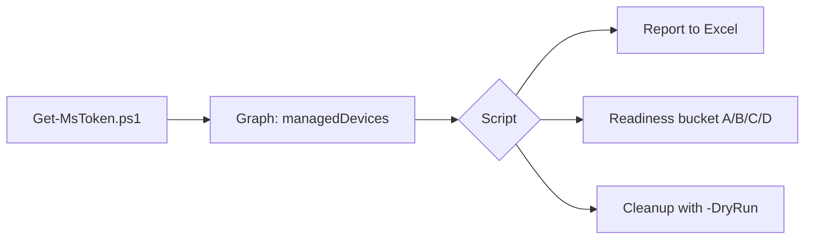

# Intune

Device reporting, BitLocker compliance, readiness checks, kiosk configuration and stale-device cleanup.

## The problem it solves

The Intune portal is fine for one device and awkward for a fleet. These scripts pull the same data through Microsoft Graph so you can answer questions like "which devices are not encrypted", "is the recovery key stored", "which laptops are ready for this change" and "what hasn't checked in for 90 days".

## How it works



Most scripts sign in with `../Graph-API/Get-MsToken.ps1`, page through Graph results, and write an Excel report to `../Reports`. `Get-DeviceReadiness.ps1` is different: it runs on the device itself as an Intune remediation detection script.

## Scripts

| Script | What it does | Changes anything? |
|--------|--------------|-------------------|
| `Get-DeviceReport.ps1` | 🔍 Managed Windows devices with encryption status and recovery keys, for all devices or a list of hostnames. | No |
| `Get-BitLockerReport.ps1` | 🔍 BitLocker compliance for a list of hostnames, labelled by rollout phase. | No |
| `Get-DeviceReadiness.ps1` | 🔍 On-device detection of Secure Boot, UEFI, virtualization and BitLocker. Puts the device in bucket A (fine), B (safe to fix remotely), C (legacy BIOS, manual) or D (unsupported make, manual). | No |
| `Deploy-KioskConfig.ps1` | ✏️ Creates an iOS web-filter profile for supervised devices and assigns it to a group. | **Creates a new profile every run.** Has `-DryRun`. |
| `Remove-StaleDevices.ps1` | ✏️ Finds devices inactive for N days and removes them from Entra ID and Intune. | **Deletes devices.** Has `-DryRun` and a yes/no prompt. |
| [`HP-Driver-Update-Loop/`](HP-Driver-Update-Loop) | 🔍✏️ Intune remediation that stops a repeating HP printer driver update. | Hides updates in Windows Update only. See its README. |

## Quick start

```powershell
# Report on every managed Windows device
.\Get-DeviceReport.ps1

# BitLocker status for one rollout phase
.\Get-BitLockerReport.ps1 -InputFile .\phase1-devices.txt -Phase "Phase1"

# Preview a cleanup first, then run it for real
.\Remove-StaleDevices.ps1 -StaleDays 90 -DryRun
.\Remove-StaleDevices.ps1 -StaleDays 90
```

## Requirements

- PowerShell 7, the [ImportExcel](https://github.com/dfinke/ImportExcel) module, and an app registration (see [Graph-API](../Graph-API)).
- Typical Graph permissions: managed device read for the reports, plus delete permissions for `Remove-StaleDevices.ps1` and device configuration write for `Deploy-KioskConfig.ps1`.
- Kiosk profiles need supervised iOS devices enrolled through Apple Business Manager.

## Good to know

- ⚠️ `Remove-StaleDevices.ps1` deletes. Run `-DryRun`, read the list, then run it.
- `Deploy-KioskConfig.ps1` uses the Graph beta endpoint. Check the profile in the portal and pilot on a small group first.
- `Get-DeviceReport.ps1` retrieves BitLocker recovery keys. Treat the Excel output as sensitive and keep it out of shared folders.
