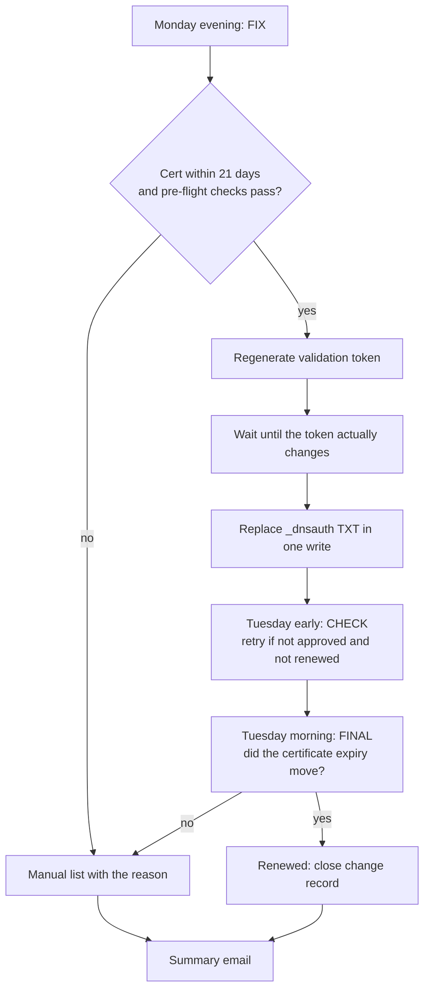

# AFD Auto Revalidation

Renews Azure Front Door managed certificates on root ("apex") domains automatically, as one scheduled Jenkins job.

## The problem it solves

Azure Front Door does not renew the managed certificate on a root domain by itself. About 45 days before expiry the domain goes to "Pending revalidation" and waits for a new validation token to be published as a `_dnsauth` TXT record. With dozens of domains, that was a manual task that depended on someone remembering. A miss means an expired certificate on a public site.

A shorter write-up is in the [case study](https://github.com/Cyb3rAvi/infra-case-studies/blob/main/02-azure-front-door-certificate-auto-renewal.md).

## How it works

One Jenkins job with three timer triggers. The mode comes from the clock.

1. **FIX (Mon 18:00 to 23:59).** For each domain within 21 days of expiry, run pre-flight checks, regenerate the token and swap the validation TXT value.
2. **CHECK (Tue 00:00 to 05:59).** Retry only what failed but is still fixable.
3. **FINAL (Tue 06:00 to 11:59).** A domain counts as renewed only if the certificate's expiry actually moved. Email a summary and list anything that needs a person.

State passes between runs in a small JSON file next to the script, so a reboot between runs loses nothing.

## Safety built in

- Every lookup is resolved **before** any change, so a bad lookup fails harmlessly.
- It never trusts the regenerate call's status. It polls until the token really changes. If it never changes, the domain is skipped and DNS is untouched.
- The `_dnsauth` record is replaced in **one** write with an `If-Match` etag, so it is never empty and never overwritten by a stale copy.
- "Approved" is not success. Only the certificate's expiry date moving counts.
- One failing domain is recorded and the run carries on. Exit code 1 if anything failed.
- `-DryRun` is read-only and writes no state or email. An `$Allowlist` limits which domains may be changed during early runs.
- It can open and close one pre-approved change record per run, and a ticketing problem never stops a renewal.

## Files

| File | What it is |
|------|------------|
| `Invoke-AfdAutoRevalidation.ps1` | The job. Windows PowerShell 5.1, certificate-based sign-in, Azure REST, no CLI. |
| `azure-permissions/role-afd-validation-token-refresher.json` | Custom role: read custom domains and refresh the validation token. Nothing else. |
| `azure-permissions/role-dns-txt-record-writer.json` | Custom role: read and write TXT record sets only. |
| `azure-permissions/Grant-AutoRevalidationPermissions.ps1` | Creates both roles and assigns them narrowly. `-Remove` backs it out. |

## Setup

1. Create an Entra app with a certificate, and install the certificate on the Jenkins server.
2. Someone with **Owner** on the subscription runs `Grant-AutoRevalidationPermissions.ps1`. The custom roles are assigned per custom domain and per `_dnsauth` record set, never at zone level, so the job cannot touch MX, SPF or any other record.
3. Edit the settings block at the top of the script: subscription, tenant, app, thumbprint, profile list, email addresses.
4. Create a Jenkins job with three timer triggers (Monday evening, Tuesday early, Tuesday morning), running the script in `Auto` mode.
5. Test with `-UseAzCliToken -DryRun` first, then set `$Allowlist` to one or two domains for the first live run.

## Good to know

- ⚠️ All values in the settings block are placeholders. The script will not work until you set them.
- It covers only root domains with managed certificates whose DNS is in Azure DNS. Anything else goes on the manual list.
- It works from a fixed list of profiles, so a new profile needs permissions added by a person. That is deliberate.
