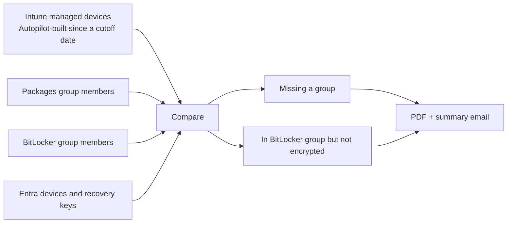

# Device Onboarding Check

A weekly, read-only report on newly built Windows devices: which ones are missing a deployment group, and which are in the BitLocker group but not encrypted.

## The problem it solves

A laptop can be built through Autopilot and still miss a group that delivers its software or encryption policy. Nobody notices until the user does. This report finds those devices the week they appear.

## How it works

1. It signs in with a certificate and pulls Windows devices from Intune (beta endpoint for the Autopilot flag), the two groups' members, Entra devices and escrowed recovery keys.
2. It keeps devices built on or after the cutoff date, and flags the two problem cases.
3. It builds a PDF with what needs action and emails a summary. A history CSV appends every week's rows, so you can see when a device first appeared and how long it stayed missing a group.

## Scripts

| Script | What it does | Changes anything? |
|--------|--------------|-------------------|
| `Get-DeviceOnboardingReport.ps1` | 🔍 Builds the weekly onboarding report and emails it. | No tenant changes. Writes a PDF and a history CSV to a local folder and sends one email. |

## Requirements

- An Entra app with a certificate and Graph application read permissions for devices, groups, Intune managed devices and BitLocker recovery key metadata.
- Windows PowerShell 5.1, Microsoft Edge on the server (used to render the HTML to PDF) and an SMTP relay.
- A weekly Jenkins schedule.

## Good to know

- Set `$BitLockerGrp`, `$PackagesGrp`, `$CutoffDate`, the addresses and the app values at the top first. They are placeholders.
- `$ShowGoodStandingTable = $false` keeps the PDF short, because compliant devices accumulate forever. The CSV keeps every device.
- ⚠️ The report lists device and user names, so handle the PDF and CSV as internal data.
