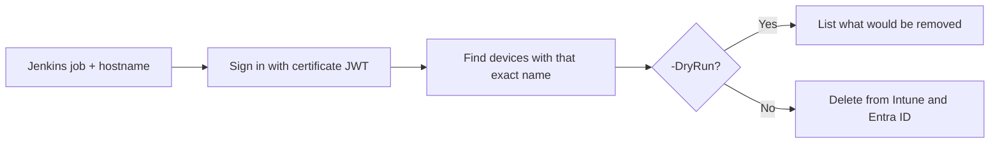

# Jenkins

Unattended, certificate-based device cleanup that a Jenkins job can run.

## The problem it solves

When a laptop is retired its Intune and Entra ID records usually linger. Doing that by hand is easy to forget. This script lets a Jenkins job remove a device by hostname with no one signed in.

## How it works



1. Jenkins runs the script under a service account that can read the certificate.
2. The script signs in with a certificate thumbprint. There is no client secret.
3. It finds every device whose name matches exactly, then lists or deletes them.

## Scripts

| Script | What it does | Changes anything? |
|--------|--------------|-------------------|
| `Remove-IntuneDevice.ps1` | ✏️ Removes a device from Intune and Entra ID by hostname. `-EntraOnly` skips Intune. | **Deletes every device with that name.** `-DryRun`. No confirmation prompt, because it runs unattended. |

## Quick start

```powershell
# Always preview first
.\Remove-IntuneDevice.ps1 -DeviceName "PC-0001" -DryRun
.\Remove-IntuneDevice.ps1 -DeviceName "PC-0001"
```

## Requirements

- An Entra app registration with a certificate, and the certificate in the machine store on the Jenkins server.
- Graph application permissions to delete Intune managed devices and Entra devices. Grant the least that covers it.
- Written for Windows PowerShell 5.1, the Jenkins default.

## Good to know

- ⚠️ If two devices share a hostname, both are deleted. `-DryRun` shows you the list first.
- Set `$tenantId`, `$clientId` and `$thumbprint` at the top before use. They're placeholders.
