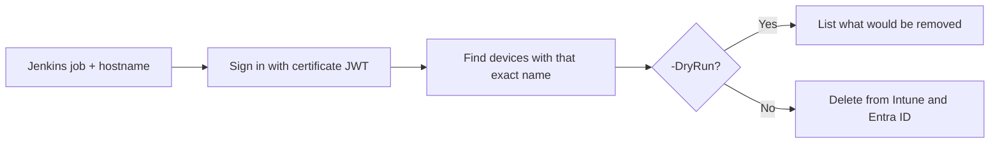

# Jenkins

Jobs and scripts for running admin tasks unattended or from a form through Jenkins, signing in with a certificate instead of a password.

## The problem it solves

Routine admin tasks (retire a device, renew a certificate, grant mailbox access, check onboarding) are easy to forget and need elevated rights. Running them as Jenkins jobs gives them a form, validation, a certificate sign-in and a record of every run. The first example below is the simplest: removing a device by hostname with no one signed in.

## How the simplest one works (`Remove-IntuneDevice.ps1`)



1. Jenkins runs the script under a service account that can read the certificate.
2. The script signs in with a certificate thumbprint. There is no client secret.
3. It finds every device whose name matches exactly, then lists or deletes them.

## Scripts

| Script | What it does | Changes anything? |
|--------|--------------|-------------------|
| `Remove-IntuneDevice.ps1` | ✏️ Removes a device from Intune and Entra ID by hostname. `-EntraOnly` skips Intune. | **Deletes every device with that name.** `-DryRun`. No confirmation prompt, because it runs unattended. |
| [`AFD-Auto-Revalidation/`](AFD-Auto-Revalidation) | ✏️ Renews Azure Front Door apex-domain certificates on a weekly schedule, with two narrow custom Azure roles. | **Writes a DNS TXT record and refreshes a validation token.** `-DryRun`, allow-list, one record at a time. |
| [`Remove-Device-By-Device-Id/`](Remove-Device-By-Device-Id) | ✏️ Removes one or many devices from Intune and/or Entra by Device ID, from a Jenkins form with a ticket number. | **Deletes devices.** Input validation, no dry-run. |
| [`Shared-Mailbox-Permissions/`](Shared-Mailbox-Permissions) | ✏️ Adds or removes FullAccess and SendAs on a shared mailbox from a Jenkins form. | **Changes permissions.** Refuses non-shared mailboxes. |
| [`Device-Onboarding-Check/`](Device-Onboarding-Check) | 🔍 Weekly report of new devices missing a deployment group or unencrypted. | No tenant changes. |

## Quick start

```powershell
# Always preview first
.\Remove-IntuneDevice.ps1 -DeviceName "PC-0001" -DryRun
.\Remove-IntuneDevice.ps1 -DeviceName "PC-0001"
```

## Requirements

- An Entra app registration with a certificate, and the certificate in the machine store on the Jenkins server.
- Graph application permissions to delete Intune managed devices and Entra devices. Grant the least that covers it.
- Written for Windows PowerShell 5.1, the Jenkins default.

## Good to know

- ⚠️ If two devices share a hostname, both are deleted. `-DryRun` shows you the list first.
- Set `$tenantId`, `$clientId` and `$thumbprint` at the top before use. They're placeholders.
