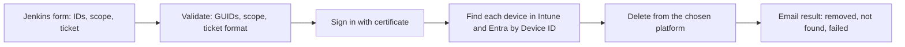

# Remove Device By Device ID

A parameterized Jenkins job that removes one or many devices from Intune, Entra ID or both, using the shared Device ID.

## The problem it solves

Retiring laptops leaves records behind, and the help desk should not need portal admin rights to clean them up. This job lets a trusted group run the removal from a Jenkins form, with validation, a ticket number and an email record of what happened.

It is the batch, ticket-aware sibling of [`../Remove-IntuneDevice.ps1`](../Remove-IntuneDevice.ps1), which removes by hostname.

## How it works

1. Jenkins passes parameters as environment variables: `DeviceIds` (comma, semicolon or newline separated), `RemoveFrom` (`IntuneOnly`, `EntraOnly` or `Both`) and `TicketNumber`.
2. The script stops before touching anything if an ID is not a valid GUID or the ticket number is not in the expected format.
3. It signs in with a certificate (no client secret), looks each device up, deletes it from the selected platform and records the outcome.
4. It emails a summary, and a different subject line if any device was not found or failed.

## Scripts

| Script | What it does | Changes anything? |
|--------|--------------|-------------------|
| `Remove-DeviceByDeviceId.ps1` | ✏️ Removes devices from Intune and/or Entra by Device ID. | **Deletes devices.** Validates input and records every outcome. No dry-run. |

## Requirements

- A Jenkins job with parameters `DeviceIds`, `RemoveFrom`, `TicketNumber`.
- An Entra app with a certificate on the Jenkins server, and Graph application permissions to delete Intune managed devices and Entra devices (least that covers it).
- Windows PowerShell 5.1 and an SMTP relay.

## Good to know

- ⚠️ This deletes. Restrict who can run the Jenkins job, and keep the ticket number mandatory so every removal is traceable.
- Placeholders (`YOUR_TENANT_ID` and so on) must be set before use.
- Jenkins sets `BUILD_USER` to the person who ran it, which the script includes in its record.
