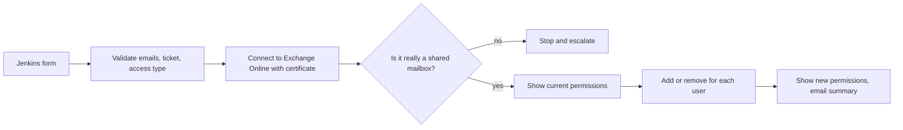

# Shared Mailbox Permissions

A parameterized Jenkins job that adds or removes FullAccess and SendAs on a shared mailbox, so the help desk can handle these requests without Exchange admin rights.

## The problem it solves

"Please give me access to the shared mailbox" is one of the most common requests, and doing it in the admin centre needs elevated rights. This job exposes just that action behind a form, with checks and a record of each change.

## How it works

1. Jenkins passes `SharedMailbox`, `UserEmail` (one or several, comma separated), `AddOrRemovePermission`, `AccessType` (`FullAccess`, `SendAs` or `Both`), `TicketNumber` and an optional `HideFromOutlook` flag.
2. The script validates every email address and the ticket number.
3. It confirms the target really is a shared mailbox, and stops if it is a user mailbox.
4. It prints the current permissions, makes the change for each user, then prints the result and emails a summary.

## Scripts

| Script | What it does | Changes anything? |
|--------|--------------|-------------------|
| `Update-SharedMailboxPermissions.ps1` | ✏️ Adds or removes FullAccess and SendAs on a shared mailbox. | **Changes mailbox permissions.** Shows before and after. No dry-run. |

## Requirements

- A Jenkins job with the parameters above.
- Exchange Online app-only sign-in with a certificate, and the `ExchangeOnlineManagement` module on the server.
- An app role that can manage mailbox permissions.

## Good to know

- ⚠️ A guard stops the job if the target is not a shared mailbox, so it can't be used to grant access to a person's own mailbox.
- Jenkins boolean parameters arrive as the strings "true" and "false", so the script compares them explicitly. A bare `If` would treat "false" as true.
- Placeholders must be set before use.
