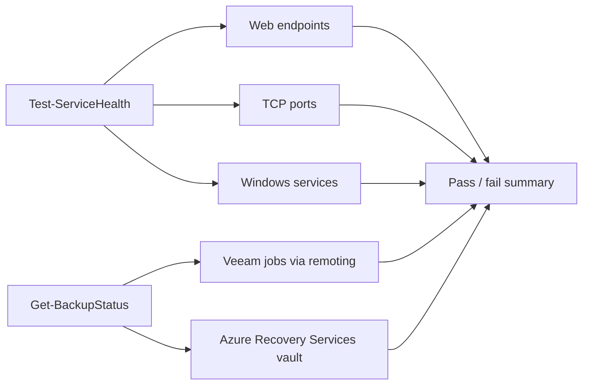

# Monitoring

Quick health and backup checks across services.

## The problem it solves

Each system has its own console. These scripts give one pass/fail view of "is everything up" and "did last night's backups run", without opening each tool.

## How it works



## Scripts

| Script | What it does | Changes anything? |
|--------|--------------|-------------------|
| `Test-ServiceHealth.ps1` | 🔍 Checks web endpoints, TCP ports and Windows services, and prints pass/fail. Uses a built-in list or a JSON config (`-ConfigFile`). | No |
| `Get-BackupStatus.ps1` | 🔍 Veeam job results plus Azure Backup vault status in one report. | No |

## Quick start

```powershell
# Default checks, or your own list
.\Test-ServiceHealth.ps1
.\Test-ServiceHealth.ps1 -ConfigFile services.json

# Backup status
.\Get-BackupStatus.ps1 -VeeamServers @("veeam01","veeam02") -AzureVaultName "prod-vault"
```

## Requirements

- `Test-ServiceHealth.ps1`: network access to the targets. Replace the `YOUR_...` placeholders or pass a config file.
- `Get-BackupStatus.ps1`: PowerShell remoting to the Veeam servers with the Veeam PowerShell module installed, and Azure access for the vault.

## Good to know

- Both are point-in-time checks, not a monitoring system. They are useful as a morning check or scheduled to send a summary.
