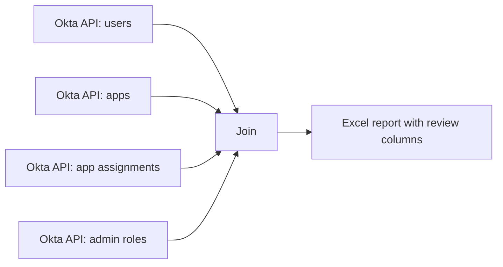

# Okta

User access reporting for periodic access reviews.

## The problem it solves

An access review needs one list of who has which apps and which admin roles. Okta spreads that across several API endpoints and paginates every one.

## How it works



The script follows Okta's `Link` header to fetch every page, joins users, apps, assignments and roles, and writes an Excel report with review columns and conditional formatting.

## Scripts

| Script | What it does | Changes anything? |
|--------|--------------|-------------------|
| `Get-OktaAccessReport.ps1` | 🔍 Users, apps, assignments and admin roles for an access review. | No, read-only API calls |

## Quick start

1. Open the script and set `$oktaDomain` and `$oktaApiToken` at the top.
2. Run it:

```powershell
.\Get-OktaAccessReport.ps1
```

## Requirements

- PowerShell 7 and ImportExcel.
- An Okta API token (SSWS) with read-only admin rights.

## Good to know

- ⚠️ Don't commit your token. Keep the placeholder in the repo copy, or read it from an environment variable or secret store.
- The report lists people and their access, so treat it as sensitive.
